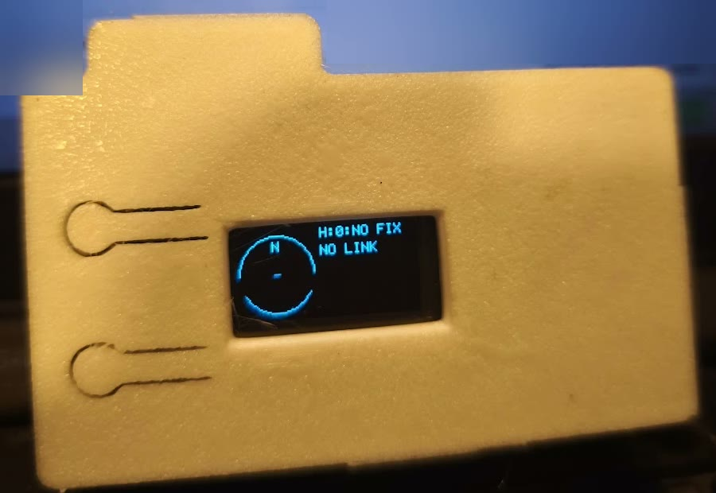
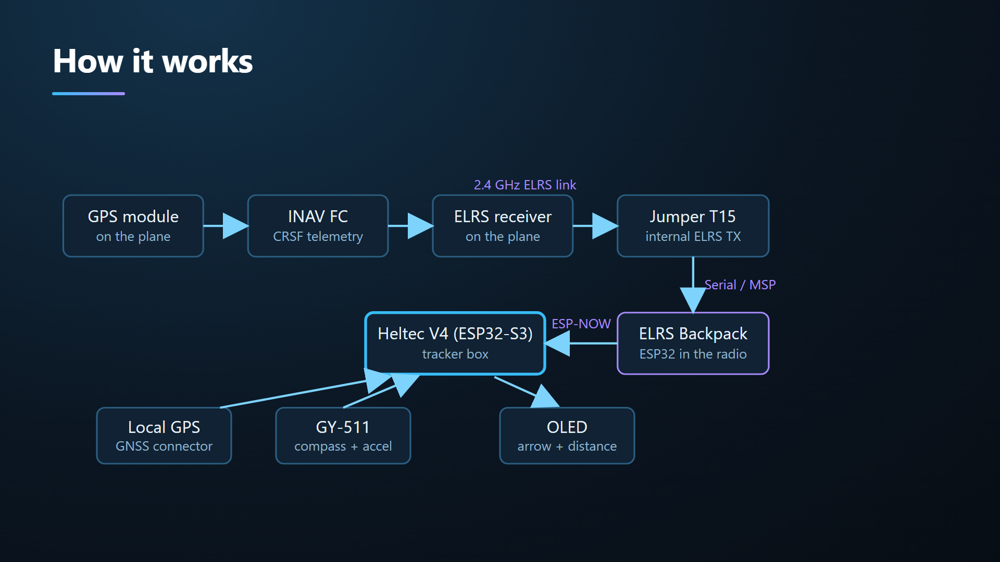
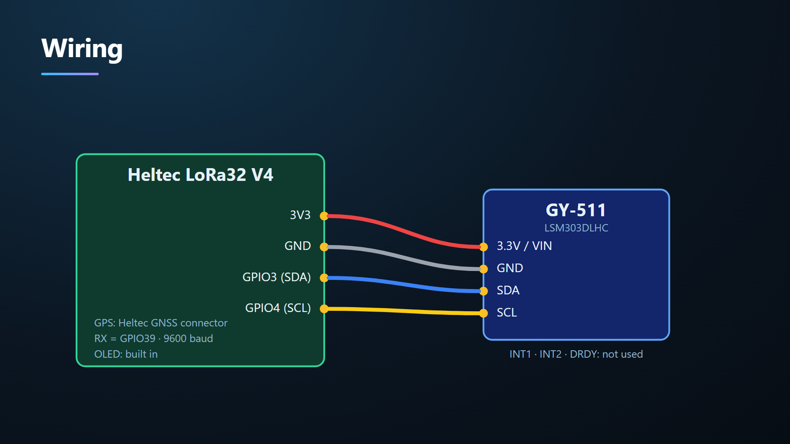
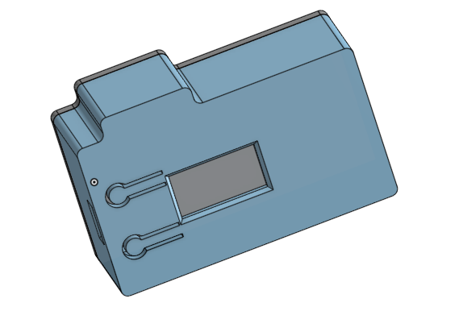
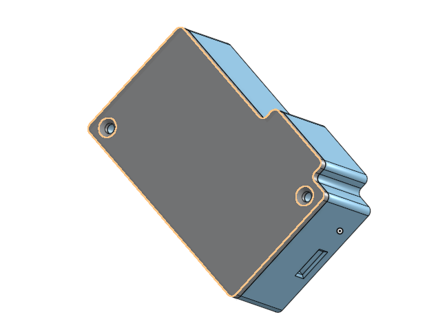
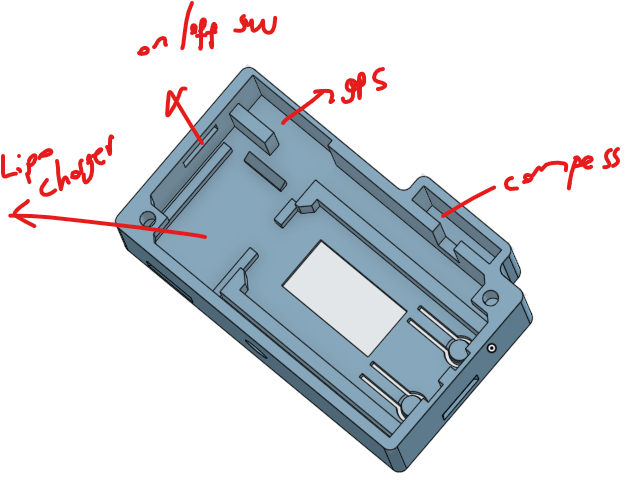

# ELRS Aircraft Tracker

A small box that mounts on your RC radio and shows **which way your plane is and how far away it is**,
whichever way you are facing.

It receives the plane's GPS position wirelessly from the radio's **ExpressLRS TX Backpack** (ESP-NOW),
combines it with its own GPS and a tilt-compensated compass, and draws an arrow and the distance on an OLED.
No wires to the radio, no extra module inside it.

<p align="center"></p>



## Features
- Arrow pointing to the plane, relative to the direction you are facing (with compass) or north-up (without)
- Distance in m / km
- Status lines: own GPS (`H`) and plane GPS (`P`) with satellite count and `LOCKED` / `NO FIX`, or `NO LINK`
- Tilt-compensated compass: mount the sensor at any angle, hold the radio tilted
- One-button compass calibration, stored in flash
- Library-free code: only the Arduino ESP32 core is needed

## What you need

### Hardware we used
| Part | Notes |
|---|---|
| Heltec WiFi LoRa 32 **V4** | ESP32-S3, built-in OLED, GNSS connector |
| GPS module for the Heltec V4 GNSS connector + GPS antenna | No antenna, no fix |
| GY-511 (LSM303DLHC) | Compass + accelerometer, I2C (optional, see below) |
| LiPo battery, LiPo charger board, on/off switch | Fit in the printed case |
| 3D printed case | STL files in [`enclosure/`](#enclosure) |

### Radio and plane
- A radio with an internal **ExpressLRS** TX module and **ELRS Backpack** (we use a Jumper T15)
- A plane with a flight controller that sends GPS over CRSF telemetry (we use **INAV**) and an ExpressLRS receiver

### Easier alternatives
- **GPS + compass combo module** (common drone modules, e.g. M10 GPS + QMC5883L): one cable for both.
  The code currently supports the LSM303DLHC; a QMC5883L driver would need to be added.
- **Any ESP32 board with a screen** (e.g. LilyGO T-Display S3): every ESP32 supports ESP-NOW.
  Change the pins in `local_gps.h` / `compass.h` and replace the display driver in `display.h`.

## Wiring



| GY-511 | Heltec V4 |
|---|---|
| 3.3V (or VIN) | 3V3 |
| GND | GND |
| SDA | GPIO3 |
| SCL | GPIO4 |

The GPS module plugs into the Heltec V4 GNSS connector (RX = GPIO39, 9600 baud). The OLED is on the board.
Mount the GY-511 on top of the box with its pins at the back (X right, Y away from you, Z up);
for other orientations change `COMPASS_RIGHT_*` in `compass.h`.
Keep it away from magnets, speakers and steel screws.

## Enclosure

3D printable case and cover in [`enclosure/`](enclosure):

| File | Part |
|---|---|
| `HeltecV4Case.stl` | Case (OLED window on the front, GY-511 seat on top) |
| `HeltecV4Cover.stl` | Back cover |

| Front | Back | Inside layout |
|---|---|---|
|  |  |  |

The inside has places for the LiPo charger, the on/off switch, the GPS module and the compass.
The case mounts on the radio near the antenna.

## Radio setup
1. **Plane:** make sure the GPS position shows up on your radio's telemetry screen
   (with a GPS connected, INAV includes it in CRSF telemetry).
2. **Radio:** open the ELRS Lua script → **Backpack** → **Telemetry** → **ESPNOW**.
3. **Tracker:** use the **same binding phrase** as your radio (next section). The tracker derives the
   same ID from it as the Backpack does, so only your radio's telemetry is received.

## Build and flash
1. Install the [Arduino ESP32 core](https://github.com/espressif/arduino-esp32) 3.x.
2. Copy `aircraft_tracker/config.example.h` to `aircraft_tracker/config.h` and set:
   - `ELRS_BINDING_PHRASE`: your binding phrase
   - `MAG_DECLINATION_DEG`: magnetic declination at your location
     (e.g. from the [NOAA calculator](https://www.ngdc.noaa.gov/geomag/calculators/magcalc.shtml))
3. Board: **Heltec WiFi LoRa 32(V4)**, *USB CDC On Boot: Enabled*. Then upload `aircraft_tracker`.

With arduino-cli:
```
arduino-cli compile -b "esp32:esp32:heltec_wifi_lora_32_V4:CDCOnBoot=cdc" aircraft_tracker
arduino-cli upload  -b "esp32:esp32:heltec_wifi_lora_32_V4:CDCOnBoot=cdc" -p <port> aircraft_tracker
```

## Using it

```
 ( arrow )   H:9:LOCKED      <- own GPS: satellites : state
 (   N   )   P:12:LOCKED     <- plane GPS (or NO LINK)
 (       )   N UP            <- shown when no compass is fitted
 (       )        850M       <- distance to the plane
```

- **Compass calibration:** with the box mounted on the radio, hold **PRG** for 2 s and rotate the radio
  in every direction for 20 s (a full turn flat, then tilt forward/back and to the sides).
  Repeat after changing anything metallic near the sensor.
- Without a compass the arrow is north-up: point the top of the box north.

### Serial commands (115200 baud)
| Command | Effect |
|---|---|
| `SIM <lat> <lon>` | Fake plane position for 15 s (test the display without flying) |
| `RAW` | Toggle raw accelerometer / magnetometer log |
| `CAL` | Start compass calibration |
| `CALINFO` | Show the stored calibration |

A status line is printed every second, including ESP-NOW packet counters, which helps when setting up the link.

## How the ESP-NOW link works
- The Backpack's ID is the first 6 bytes of `MD5('-DMY_BINDING_PHRASE="<phrase>"')`, with bit 0 of the first byte cleared.
- The Backpack sets its WiFi STA MAC to that ID and unicasts telemetry to it on channel 1,
  so the tracker sets its own STA MAC to the same ID.
- Each packet is an MSP v2 frame (function `0x0011`) carrying a raw CRSF frame; the tracker decodes CRSF GPS frames (`0x02`).

Details are in `aircraft_tracker/elrs_link.h`.

## Credits
- ESP-NOW protocol details from the [ExpressLRS Backpack](https://github.com/ExpressLRS/Backpack) source.
- Heltec V4 GNSS power/reset pin mapping from [Meshtastic](https://github.com/meshtastic/firmware).
